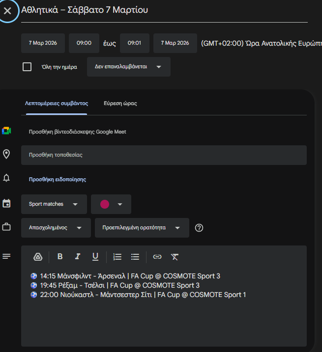

# Sports FM TV Schedule → Google Calendar

Scrapes [sport-fm.gr/tv](https://www.sport-fm.gr/tv) daily, φιλτράρει τα events με Claude AI βάσει προσωπικών προτιμήσεων, και δημιουργεί ένα Google Calendar event με τα αθλητικά της ημέρας.

**Example event:**

    Title: Αθλητικά – Παρασκευή 7 Μαρτίου
    Date: Friday, March 7, 09:00 – 09:01
    Description:
    ⚽ 19:45 Arsenal - Manchester City | Champions League, TNT Sports
    🏀 21:00 Ολυμπιακός - Παναθηναϊκός | EuroLeague, Novasports Prime
    


## Subscribe to the Calendar

Αν δεν θέλεις να τρέξεις το project μόνος σου, μπορείς να κάνεις απευθείας subscribe στο calendar:

👉 [Subscribe στο Google Calendar](https://calendar.google.com/calendar/u/0?cid=NGI4YzBjY2RkMWZmNDM0ZmQzNjg0ZmQ2MTllZTFmZjYyNWE0NTBkNGU1OWI1NzQ1NDkzODgyMjU3MjM5ZTdiOEBncm91cC5jYWxlbmRhci5nb29nbGUuY29t)

---

## Prerequisites

### 1. Google Cloud — OAuth Credentials

1. Πήγαινε στο [console.cloud.google.com](https://console.cloud.google.com)
2. Ενεργοποίησε το **Google Calendar API**: APIs & Services → Enable APIs
3. Δημιούργησε credentials: APIs & Services → Credentials → Create Credentials → **OAuth 2.0 Client ID** (Desktop app)
4. Κατέβασε το JSON → αποθήκευσε ως `.credentials/credentials.json`
5. Πρόσθεσε τον εαυτό σου ως test user στο OAuth consent screen
6. Βρες το **Calendar ID**: Google Calendar → Settings → (επίλεξε ημερολόγιο) → Calendar ID

### 2. Anthropic API Key (προαιρετικό)

Αν θέλεις φιλτράρισμα με Claude AI, δημιούργησε API key στο [console.anthropic.com](https://console.anthropic.com).
Αν δεν οριστεί, το script δημιουργεί event με όλα τα events χωρίς φιλτράρισμα.

### 3. Αρχείο `.env`

Αντέγραψε το `.env.example` σε `.env` και συμπλήρωσε:

```
URL_TO_SCRAPE=https://www.sport-fm.gr/tv
CREDENTIALS_JSON_PATH=.credentials/credentials.json
CALENDAR_ID=your-calendar-id@group.calendar.google.com
ANTHROPIC_API_KEY=sk-ant-...
CLAUDE_MODEL=claude-haiku-4-5
```

### 4. Προτιμήσεις φιλτραρίσματος

Επεξεργάσου το αρχείο `prompts/preferences.txt` με τις διοργανώσεις/ομάδες που σε ενδιαφέρουν.

Προσοχή στον διαχωρισμό: στο `preferences.txt` μπαίνουν **μόνο κανόνες που θέλουν κρίση** («μόνο derby Ολυμπιακού–Παναθηναϊκού»). Οι κανόνες που είναι αριθμητική ή lookup ζουν σε κώδικα, στο [events.py](events.py):

| Κανόνας | Πού ζει |
|---|---|
| Παράθυρο έναρξης (10:00–23:30 CET) | `WINDOW_START` / `WINDOW_END` |
| Αποκλεισμός NBA | `EXCLUDED_TOURNAMENTS` |
| Μετατροπή ώρας Αθήνα → Ζυρίχη | `to_target_tz()` (μέσω `zoneinfo`, χειρίζεται μόνο του θερινή ώρα) |
| Emoji ανά άθλημα | `_SPORT_PATTERNS` |
| Ποια events ταιριάζουν στις προτιμήσεις | **το LLM** ([claude_utils.py](claude_utils.py)) |

Αυτό κρατά το μοντέλο σε ένα στενό interface (`list[TvEvent] -> list[int]`, μέσω structured outputs) και εμποδίζει σιωπηλά λάθη σε ό,τι μπορεί να υπολογιστεί ντετερμινιστικά.

---

## Local Development

```bash
python -m venv venv
source venv/bin/activate        # Linux/Mac
# ή: venv\Scripts\activate      # Windows

pip install -r requirements.txt
python scrape.py
```

Η πρώτη εκτέλεση ανοίγει browser για OAuth → δημιουργείται `token.pickle` στο `.credentials/`.

Για verbose output: `LOG_LEVEL=DEBUG python scrape.py` (δείχνει ποια events κόπηκαν και γιατί).

### Tests

```bash
pip install -r requirements-dev.txt
pytest
```

Τα tests τρέχουν πάνω σε πραγματικό HTML snapshot (`tests/fixtures/tv_2026-11-14.html`) — **χωρίς network, χωρίς API calls**. Η σελίδα σερβίρει πέντε ημέρες (2 περασμένες, σήμερα, 2 επόμενες) σε ένα HTML ως tab panels, και το `tv_page.parse_events()` κρατά μόνο το panel της ζητούμενης ημερομηνίας, **ταιριάζοντας dd/mm** αντί να εμπιστεύεται το `is-active` (που σε cached σελίδα δείχνει λάθος μέρα σιωπηλά).

Όταν αλλάξει ξανά η σελίδα: κατέβασε νέο snapshot, αντικατέστησε το fixture και ενημέρωσε τα `PANEL_COUNTS` στο [tests/test_tv_page.py](tests/test_tv_page.py).

---

## Docker (Production — Raspberry Pi)

Το Docker image τρέχει αυτόματα κάθε μέρα στις **08:00 Athens time** (Europe/Athens timezone).

### Setup

```bash
# Clone
git clone https://github.com/<username>/sports-fm-tv-schedule.git
cd sports-fm-tv-schedule

# Αντέγραψε secrets από το laptop
scp .env pi@<RPi-IP>:~/sports-fm-tv-schedule/
scp -r .credentials/ pi@<RPi-IP>:~/sports-fm-tv-schedule/

# Build & start
docker compose up -d --build
```

### Χειροκίνητη εκτέλεση (test)

```bash
docker compose run --rm sport-fm python scrape.py
```

### Logs

```bash
docker compose logs -f
# ή μέσα στο container:
docker exec <container_id> cat /var/log/sport-fm.log
```

---

## Project Structure

```
├── scrape.py           # Entry point — orchestration
├── tv_page.py          # Fetch + parsing (επιλογή panel ημέρας, CSS selectors)
├── events.py           # TvEvent model, timezone, prefilter, emoji, formatting
├── claude_utils.py     # Σημασιολογική επιλογή μέσω Claude (structured outputs)
├── calendar_utils.py   # Google Calendar event creation
├── prompts/
│   ├── preferences.txt # Προτιμήσεις που θέλουν κρίση (διοργανώσεις, ομάδες)
│   ├── instructions.txt# Prompt template
│   └── system.txt      # System prompt για Claude
├── tests/
│   ├── test_tv_page.py # Tests parsing/timezone/emoji/prefilter
│   └── fixtures/       # Πραγματικό HTML snapshot του sport-fm.gr/tv
├── Dockerfile          # python:3.12-slim + cron, τρέχει 08:00 Athens time
├── docker/
│   ├── entrypoint.sh   # Γράφει το env για το cron (quoted), ξεκινά cron, tail -F
│   └── run-job.sh      # Το cron job: φορτώνει env, rotate log, τρέχει scrape.py
├── docker-compose.yml  # Volume mounts για .credentials/
└── .env.example        # Template για environment variables
```

### Ροή

```
fetch_page ──▶ parse_events(html, today)   μόνο το panel της σημερινής dd/mm
                      │                     29 events (όχι 135)
                      ▼
               prefilter()                  ώρες + NBA, ντετερμινιστικά
                      │                     25 events
                      ▼
               select_events()              LLM: μόνο κρίση → indices
                      │                     ~10 events
                      ▼
               format_description()          emoji + ώρες, σε Python
                      │
                      ▼
               create_google_cal_event()
```
